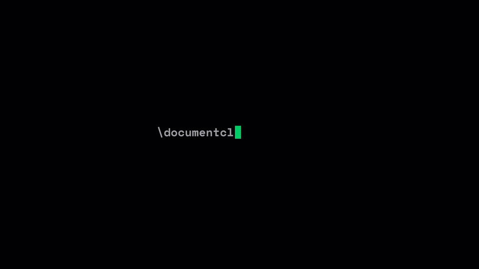

<div align="center">


# OverBranch

**The Open-Source, Self-Hosted Agentic LaTeX Studio**

*Lightning-fast local TeX compilation, autonomous AI reasoning & edits, reverse PDF-to-LaTeX engineering, and real-time multi-user collaboration.*

<p align="center">
  <a href="LICENSE"></a>
  <a href="https://nextjs.org/"></a>
  <a href="https://fastapi.tiangolo.com/"></a>
  <a href="docker-compose.yml"></a>
  <a href="https://github.com/abin-karukappallil/overbranch/pulls"></a>
</p>

<p align="center">
  <a href="#overview">Overview</a> &bull;
  <a href="#features">Features</a> &bull;
  <a href="#docker-deployment">Docker Deployment</a> &bull;
  <a href="#local-development">Local Development</a> &bull;
  <a href="#license">License</a>
</p>

</div>

---

## Overview

<div align="center">

[](./public/demo.mp4)

<p align="center"><sub>Click preview to open the high-definition video with audio (<code>public/demo.mp4</code>).</sub></p>

</div>

OverBranch provides unlimited local TeX compilation without cloud queue restrictions, an integrated agentic AI copilot for document generation and syntax repair, and collaborative real-time editing with live multi-cursor presence.

---

## Features

- **Instant TeX Compilation**: Real-time PDF compilation via `pdflatex` and `latexmk` with an instant fallback renderer.
- **Built-in AI Copilot**: Autonomous LaTeX edits, document generation, and syntax repairs powered by Groq and custom model endpoints.
- **Real-Time Collaboration**: Seamless multi-user co-authoring with live cursor presence and automatic document synchronization.
- **PDF to LaTeX Reverse Importer**: Decompiles existing PDFs into clean, compilable LaTeX—extracting text, fonts, colors, layout structures, and figures with per-page fidelity scoring.
- **Asset Manager**: Asset uploads and management with an inline preview modal and copyable LaTeX snippets.
- **Responsive Workspace**: Adaptive collapsible layout optimized for desktop, tablet, and mobile authoring.
- **Self-Contained Container**: Zero external cloud dependency. Fully containerized and deployable to standard Linux, macOS, or Windows environments.

---

## Docker Deployment

Deploy OverBranch locally or on a server using Docker Compose:

```bash
git clone https://github.com/abin-karukappallil/overbranch.git
cd overbranch
cp .env.example .env
docker compose up --build -d
```

| Service | Endpoint |
| :--- | :--- |
| **Web Workspace** | `http://localhost:3000` |
| **FastAPI Engine** | `http://localhost:8000` |

---

## Local Development

### 1. Frontend (Next.js)
```bash
bun install
bun dev
```

### 2. Backend (FastAPI Python Engine)
```bash
cd backend
python -m venv .venv
source .venv/bin/activate  # On Windows: .venv\Scripts\activate
pip install -r requirements.txt
uvicorn main:app --host 0.0.0.0 --port 8000 --reload
```

The PDF importer requires TeX Live with `pdflatex` and `pdftoppm` (`poppler-utils`):

- **Debian / Ubuntu**: `sudo apt install texlive-latex-extra texlive-pictures texlive-fonts-recommended poppler-utils`
- **Arch Linux**: `sudo pacman -S texlive-latexextra texlive-pictures poppler`

To run backend tests:
```bash
cd backend && pytest tests/test_pdf2latex_*.py -v
```

---

## License

Distributed under the [MIT License](LICENSE).
